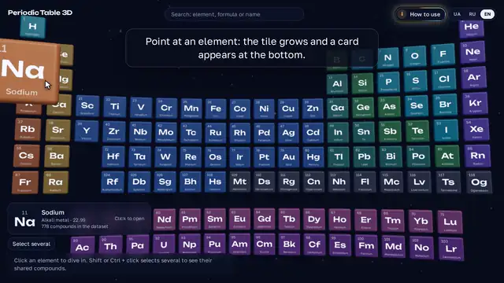

# Periodic Table 3D

**English** · [Українська](README.uk.md) · [Русский](README.ru.md)

An interactive 3D periodic table. Click an element and fly inside it: glowing rays lead
to the elements it forms compounds with, and each ray carries the compounds of that
pair. Open a compound to see its molecule or crystal slowly rotating in 3D, with its
formula, composition, properties and sources beside it. Pick several elements to get a
cloud of compounds that contain all of them.

**Open the site:** https://vik753.github.io/periodic-3d/ — free, no sign-up, works in a
desktop browser and on a phone. The interface speaks Ukrainian, Russian and English.

## Video guide

[](https://vik753.github.io/periodic-3d/about?video&lang=en)

**[▶ Watch the full video (2 min)](https://vik753.github.io/periodic-3d/about?video&lang=en)**: it opens on the site, over the
table, with play, pause and seeking. On the site itself: **How to use** → **Watch the
video**. The video files: [English](https://github.com/vik753/periodic-3d/releases/download/guide-2026.10.11-r4/guide-en.mp4) ·
[Українською](https://github.com/vik753/periodic-3d/releases/download/guide-2026.10.11-r4/guide-uk.mp4) · [По-русски](https://github.com/vik753/periodic-3d/releases/download/guide-2026.10.11-r4/guide-ru.mp4).

> [!IMPORTANT]
> **The data is checked.** Formulas, masses and structures come from open scientific
> databases and are cross-checked between independent sources before each release.
> See [How we make sure the data is right](#how-we-make-sure-the-data-is-right).

## Contents

- [Guide for new visitors](#guide-for-new-visitors)
  - [1. The table](#1-the-table)
  - [2. Inside an element](#2-inside-an-element)
  - [3. Walk along a ray](#3-walk-along-a-ray)
  - [4. The compound card](#4-the-compound-card)
  - [5. Several elements: the cloud of compounds](#5-several-elements-the-cloud-of-compounds)
  - [6. Predicted materials (violet)](#6-predicted-materials-violet)
  - [7. Search](#7-search)
  - [8. Links, language and keyboard](#8-links-language-and-keyboard)
  - [9. On a phone](#9-on-a-phone)
  - [10. Questions and problems](#10-questions-and-problems)
- [**How we make sure the data is right**](#how-we-make-sure-the-data-is-right)
- [Dataset](#dataset)
- [For developers](#for-developers)
- [Data sources and licenses](#data-sources-and-licenses)

## Guide for new visitors

### 1. The table

The home screen shows all 118 elements as tiles that float in space. The colour of a tile
tells the family of the element: alkali metals, noble gases, lanthanides and so on.

| What you want | Mouse | Touch screen |
| --- | --- | --- |
| Read an element | Point at a tile: it grows and a card with name, family and mass appears at the bottom | Tap a tile once |
| Open an element | Click the tile | Tap the same tile again, or tap **Open** on the card |
| Come closer | Scroll the wheel: the table zooms towards the element under the cursor; one or two scrolls bring one tile close | Pinch with two fingers |
| Zoom with the keyboard | `+` and `−` | — |
| Tilt or move the table | Drag with the left button (tilt) or the right button (move) | Drag with one or two fingers |

Each tile shows the atomic number, the symbol and the name. The letters stay sharp even
when one tile fills the screen.


### 2. Inside an element

Click a tile and the camera flies into the element.

- **The atom.** In the middle you see the Bohr model: the nucleus and the electrons on
  their shells. The switch **Atom / Substance in 3D** shows the simple substance
  instead: the O₂ molecule, the iron crystal, graphite layers.
- **Red rays** lead to the elements that form compounds with this one. A thick ray means
  many shared compounds. Point at a ray or at a partner tile to see how many.
- **The panel** on the right (at the bottom on a phone) gives the facts: atomic mass,
  electron configuration, melting and boiling points, density, the year of discovery, a
  photo of the substance, the best-known compounds and similar elements.


To come back, press **To the table** at the top, press `Esc`, or click empty space.

### 3. Walk along a ray

Click a red ray. The camera stands on the ray, and the compounds of the two elements line
up along it, the best known first.

- Drag along the ray, scroll the wheel or press the arrow keys to move from compound
  to compound.
- Click the compound in front of you, or **Open the card**, to see its details.
- **Back to Fe** (or another symbol) returns to the element.


### 4. The compound card

The card shows one compound: the 3D model on the left and the facts on the right.

- **The model.** A molecule with its bonds, a fragment of a crystal lattice, or a flat
  diagram when no 3D shape is known. Drag to turn it, scroll or pinch to zoom. Each atom has the
  colour and label of its element.
- **Where a crystal comes from.** Under the model type the card says *Structure from
  experiment (ICSD)* when the crystal was measured in a lab, or *Computed structure only*
  when it exists only in a calculation.
- **Formula and composition.** How many atoms of each element, and the molar mass. When
  the mass is computed from the formula, the card says so.
- **Source check.** Wikidata, PubChem and the structural formula (SMILES) are compared.
  When they disagree, a yellow note explains what the card shows and why.
- **Description** from Wikipedia, the type of substance (oxide, acid, mineral…), a photo,
  **similar compounds**, and the **sources and licenses** of every piece of data.
- **Report an error** opens a ready GitHub issue with the record number. Write what is
  wrong; a link to a source helps.

When a compound has no 3D model, spheres show its composition: one sphere for each atom.


### 5. Several elements: the cloud of compounds

You can pick several elements and see what they make together.

1. Hold `Shift` or `Ctrl` and click the tiles. On a phone, press **Select several**,
   then tap the tiles. Press **Done** when you finish.
2. A bar at the bottom of the screen lists the chosen elements. Press **Show
   compounds**. **Clear selection** starts again.
3. A cloud of glowing orbs appears: one orb is one compound. Point at an orb to read its
   name, click it to open the card.

In the panel of the cloud you can:

- choose **Contain all** (compounds with all chosen elements and maybe others) or **Only
  these** (nothing else inside);
- filter by kind: **All**, **Organic**, **Inorganic**, **Minerals**;
- see the **other elements** of these compounds: they light up in cyan on the table, and a
  click adds one to the selection;
- add **predicted materials**: violet orbs (see the next section).


### 6. Predicted materials (violet)

Next to the 27 000 known compounds the site shows **554 054 predicted crystals**. The
GNoME neural network (Google DeepMind) proposed them, and a quantum-mechanical
calculation (DFT) found them stable. Most of them have never been made in a lab.

Predicted materials never mix with known compounds. They are always **violet**:

- inside an element, the button **Show the violet rays** adds violet rays to partners;
- a click on a violet ray starts a walk through the predicted materials of the pair, the
  simplest first;
- in the cloud, **+ predicted materials** adds violet orbs.

The card of a predicted material shows its unit cell in 3D, the crystal system, the space
group and the calculated properties: decomposition energy (zero or below means stable),
formation energy and band gap. A badge says *Predicted by computation, not confirmed by
experiment*.


### 7. Search

The search field is at the top. Press `/` or `Ctrl`+`K` to jump into it.

- Type a symbol (`Fe`), a formula (`H2O`, `NaCl`) or a name in any of the three languages
  (`вода`, `water`, `кварц`).
- Use the arrow keys and `Enter` to open a result, or click it.
- The ID of a predicted material (ten characters, for example `df6697e2c1`) opens its card.

### 8. Links, language and keyboard

**Every view has its own address.** Copy the address bar and send it: the other person
sees the same scene.

| Address | What opens |
| --- | --- |
| `/e/Fe` | iron with its rays |
| `/e/Fe/O` | the walk along the iron–oxygen ray |
| `/e/Fe/O/predicted` | the walk through predicted iron–oxygen materials |
| `/c/Q283` | the card of a compound (here water, by its Wikidata ID) |
| `/m/df6697e2c1` | the card of a predicted material |
| `/set/Fe-O` | the cloud of compounds with iron and oxygen |
| `/about` | how to use the site and where the data comes from |

**Language.** The switch at the top changes the interface between Ukrainian, Russian and
English. The site starts in the language of your browser.

**Keyboard.** `Tab` moves through all 118 elements in order, `Enter` opens one. `Esc`
goes back. `/` opens the search. When your system asks for less motion, the camera jumps
instead of flying, and the dust and the atoms stop moving.

### 9. On a phone

- Tap a tile to magnify it, tap again to open it.
- Pinch to zoom; drag with one finger to turn a model.
- The panel with facts sits at the bottom of the screen; scroll inside it to read more.
- On slow phones the site lowers the rendering quality by itself to keep the motion
  smooth.

### 10. Questions and problems

- **The screen stays black.** The site needs WebGL. Update the browser, or turn on
  hardware acceleration in its settings.
- **The data looks wrong.** Open the card and press **Report an error**.
- **Where does the data come from?** The **How to use** button at the top opens the page
  with the dataset version, the sources and their licenses.

## How we make sure the data is right

> [!IMPORTANT]
> The site does not invent chemistry. Every formula, mass and structure comes from open
> scientific databases. Each compound is checked against several independent sources, and
> a new dataset goes live only after a set of well-known substances comes out right. Every
> card names its sources and their licenses, and anyone can report an error in one click.

### Where the data comes from

| Source | What we take | License |
| --- | --- | --- |
| [Wikidata](https://www.wikidata.org) | the list of compounds, formulas, names in three languages, classes, SMILES, links to PubChem and Materials Project | CC0 |
| [PubChem](https://pubchem.ncbi.nlm.nih.gov) (US National Institutes of Health) | formula, molar mass, IUPAC name, 3D shapes of molecules | public domain |
| [Materials Project](https://materialsproject.org) | crystal structures, and whether a structure was measured in a lab (ICSD records) | CC BY 4.0 |
| [Wikipedia](https://www.wikipedia.org) | descriptions | CC BY-SA 4.0 |
| [Wikimedia Commons](https://commons.wikimedia.org) | photos, with author and license under each | per photo |
| [RDKit](https://www.rdkit.org) | 3D models computed from SMILES when PubChem has none | BSD |
| [GNoME](https://github.com/google-deepmind/materials_discovery) (Google DeepMind) | predicted crystals: a separate violet layer | CC BY-NC 4.0 |

### How we check it

Every dataset goes through the same checks. The numbers below are for the dataset that the
site uses now (`data-2026.10.11-r39`).

1. **Only notable substances.** A compound gets in when it has a Wikipedia article in
   English, Ukrainian or Russian: 27 202 compounds.
2. **Three independent records per compound.** We compare the Wikidata formula, the
   PubChem formula and the formula that follows from the structure (SMILES). When two of
   them agree, the third one is the error.

   | Result | Compounds |
   | --- | --- |
   | Wikidata and PubChem agree | 22 647 |
   | No PubChem record (the mass comes from the formula) | 4 227 |
   | They disagree and no third source decides: the card shows both formulas | 222 |
   | The PubChem link led to another substance: removed | 62 |
   | The Wikidata formula was wrong: fixed | 28 |
   | PubChem describes the hydrate or the anhydrous form: the Wikidata formula stays | 12 |
   | Same proportions, other size (a dimer record) | 3 |
   | Isotopes (D, T, ¹⁸F): PubChem's notation is used | 1 |

3. **Careful fixes.** We change a formula only for plain organic molecules and for obvious
   typos. Salts, complexes and inorganic compounds keep their formula, and the card shows
   the conflict instead. Our first rules were too bold: they "fixed" 239 formulas, among
   them correct salts and complexes. Stricter rules left 28 real fixes.
4. **The mass says where it comes from.** It is PubChem's value, or it is computed from
   the formula with standard atomic weights; the card says which.
5. **Every 3D model must match its formula,** atom by atom. The build rejected 26 PubChem
   shapes, 97 RDKit models and 85 crystal cells that did not fit their compound.
6. **Measured before computed.** For crystals we prefer structures that were measured in a
   lab: 4 181 crystals come from experiment (ICSD), 504 exist only in calculations, and the
   card says so. This rule replaced the computed structure of 154 compounds (FeO, BeO, CuO,
   V₂O₅, hydroxyapatite…) with a measured one.
7. **A golden set guards each release.** 19 well-known substances (water, benzene,
   caffeine, sulfuric acid, sodium chloride, diamond, graphite, quartz, hematite…) must
   have the right formula, the mass within 0.3%, the right kind of 3D model and the right
   cell shape. If one fails, the dataset is not published. Now: 19 of 19.
8. **Known and predicted never mix.** GNoME materials are always violet and marked
   "predicted by computation, not confirmed by experiment".
9. **Everything is on record.** Each dataset is a versioned GitHub release with a full
   report that lists every fix and every removed link.

### Errors we found and fixed

| Where | What was wrong | What we did |
| --- | --- | --- |
| Wikidata | Potassium chlorate written as KCIO₃: a capital I instead of l, which reads as carbon and iodine | KClO₃ |
| Wikidata | Soman, a nerve agent, without its phosphorus: C₇H₁₆FO₂ | C₇H₁₆FO₂P |
| Wikidata | 1,5-pentanediol two hydrogens short: C₅H₁₀O₂ | C₅H₁₂O₂ |
| Wikidata | 2-aminopyridine as C₄H₅N₃ | C₅H₆N₂ |
| Wikidata → PubChem | Indigo linked to indigo carmine, a sodium salt of another dye | link removed |
| Wikidata → PubChem | Strontium bromide linked to an organic compound, C₁₂H₁₇N | link removed |
| Wikidata → PubChem | Pyridinium chlorochromate linked to C₁₃H₁₈S | link removed |
| Materials Project API | The API switched to letter IDs (`mp-aaaaaaco` is `mp-66`, diamond), so no crystal got its "measured / computed" mark | we decode both forms; a test keeps it so |

In total: 28 formulas fixed, 62 wrong links removed, 222 conflicts shown openly.

### Found an error?

Open the card and press **Report an error**. It opens a ready GitHub issue with the record
number; write what is wrong and, if you can, add a link to a source.

## Dataset

27 202 compounds that have a Wikipedia article in English, Russian or Ukrainian
(selection rules: [ADR 0004](docs/adr/0004-data-sources-and-selection.md)); 25 554 (94%)
have a 3D model: PubChem conformers, crystals from Materials Project, RDKit for the rest;
salts and hydrates are shown as ions side by side. Crystals that match an experimental
record (ICSD, through the Materials Project API) are preferred and marked. Formulas are
cross-checked between Wikidata, PubChem and SMILES, and a golden set of well-known
substances must pass before a release. Each dataset version is a GitHub release
(`data-<version>`); `data/DATASET` says which one the site uses.

The predicted layer is a separate build (`p3d-pipeline gnome`, workflow `gnome`): a
release `gnome-<version>` that `data/GNOME` points to. The browser loads one small file
per material card (about 8 materials, under 3 KB gzip) and builds the unit cell itself
([ADR 0007](docs/adr/0007-gnome-layer.md)).

## For developers

### Architecture

```text
sources ──► pipeline (Python, offline) ──► dataset ──┬─► PostgreSQL + pgvector ──► FastAPI ──┐
PubChem, Materials Project,                           │                                       ├─► CDN ──► web (React + R3F)
Wikidata, Wikipedia, GNoME                            └─► static export (JSON) ───────────────┘
```

| Part | Stack |
| --- | --- |
| `apps/web` | React 19, TypeScript, Vite, three.js, React Three Fiber, drei, zustand, TanStack Query, i18next, Tailwind CSS |
| `apps/api` | Python 3.12, FastAPI, SQLAlchemy 2 (async), asyncpg, Alembic, PostgreSQL 17 + pgvector, pg_trgm |
| `pipeline` | Python 3.12, httpx, tenacity, RDKit, spglib, numpy, Typer |
| CI/CD | GitHub Actions (checks, data builds, screenshots, load and speed tests), GitHub Pages (artifact deploy) |

Design decisions are recorded in [docs/adr](docs/adr); the plan is in
[docs/plan.md](docs/plan.md).

### Run it

- Demo: nothing to do — every push to `main` rebuilds and deploys the site.
- Own server (Docker Compose), managed cloud services or local development: see
  [docs/DEPLOY.md](docs/DEPLOY.md).

### Performance budgets

| Metric | Budget | Measured (CI) |
| --- | --- | --- |
| Initial JavaScript (gzip) | ≤ 400 KB | ≈ 380 KB |
| LCP on 4G (9 Mbit/s, 170 ms) | ≤ 2.5 s | ≈ 0.85 s desktop, ≈ 1.1 s phone (CPU ×4) |
| Draw calls per frame | ≤ 100 | 3–14 |
| 3D structure file (gzip), 95% of compounds | ≤ 20 KB | ≈ 1.5 KB |
| API p95 without cache, 4 parallel requests, full dataset | ≤ 300 ms | 14–66 ms per endpoint |

## Data sources and licenses

The source code is MIT-licensed. Chemical data keeps the licenses of its sources:
Wikidata (CC0), Wikipedia (CC BY-SA 4.0), PubChem (NIH, public domain), Materials
Project (CC BY 4.0), Wikimedia Commons (license per photo), GNoME by Google DeepMind
(CC BY-NC 4.0). The site's About page and [docs/data-sources.md](docs/data-sources.md)
list the details.

**Non-commercial.** The layer of predicted materials comes from GNoME under CC BY-NC 4.0.
While the site shows it, the site stays free and non-commercial: no ads, no paid access.
Citation: A. Merchant et al., "Scaling deep learning for materials discovery", Nature 624,
80–85 (2023), https://doi.org/10.1038/s41586-023-06735-9.

## License

[MIT](LICENSE) © 2026 Ihor Korenets
