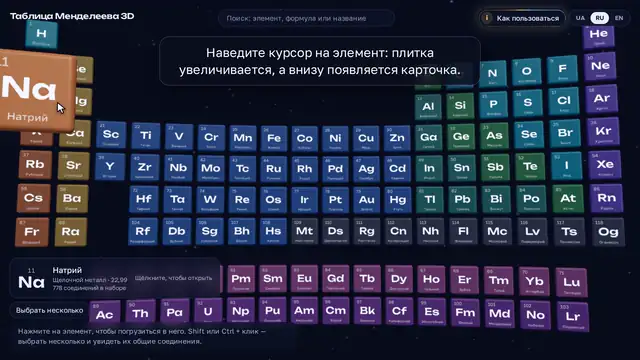
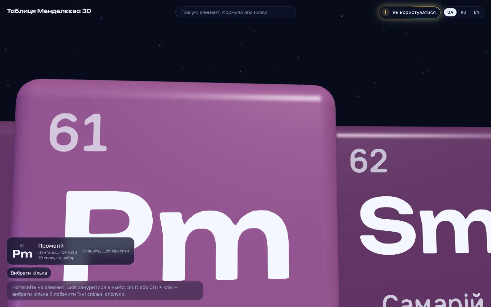
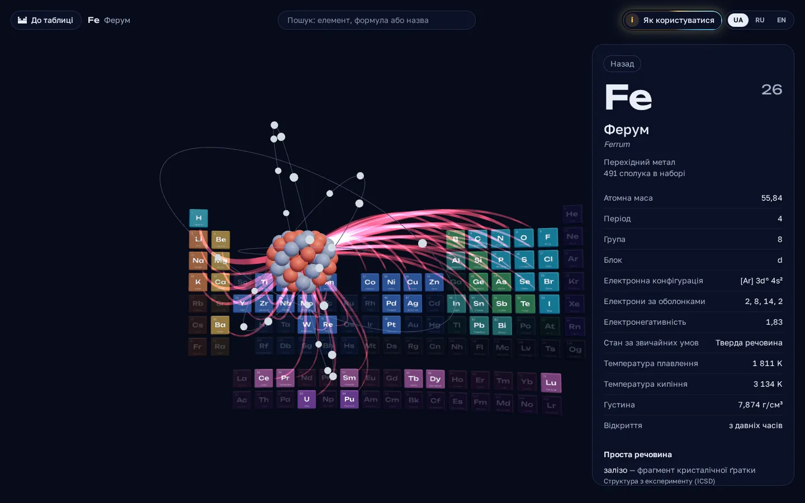
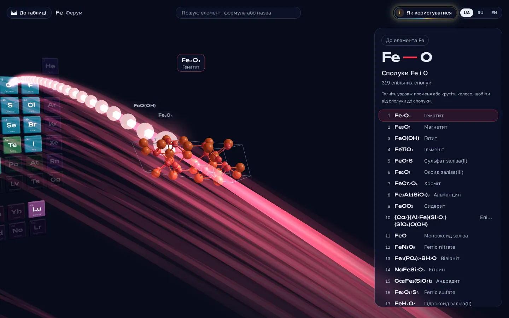
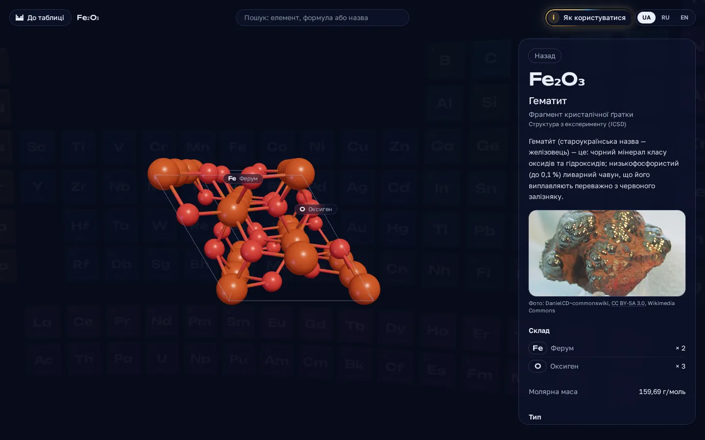
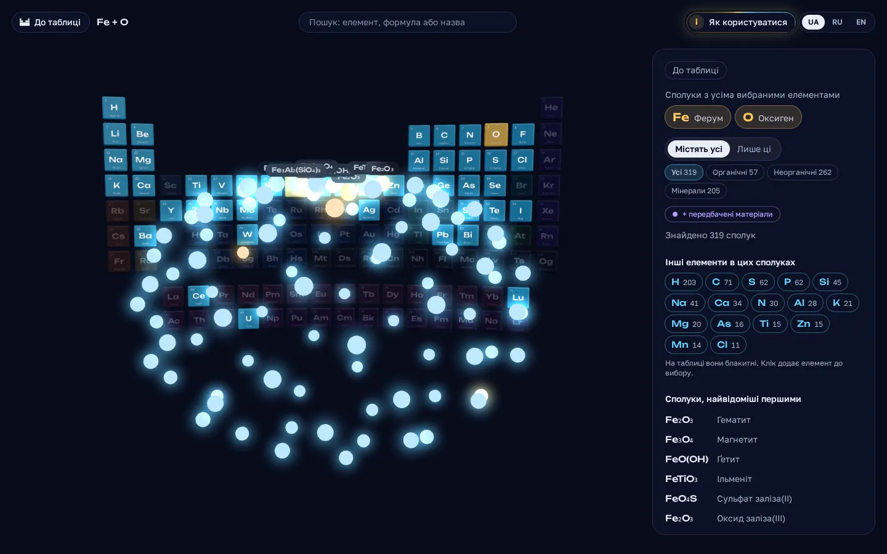
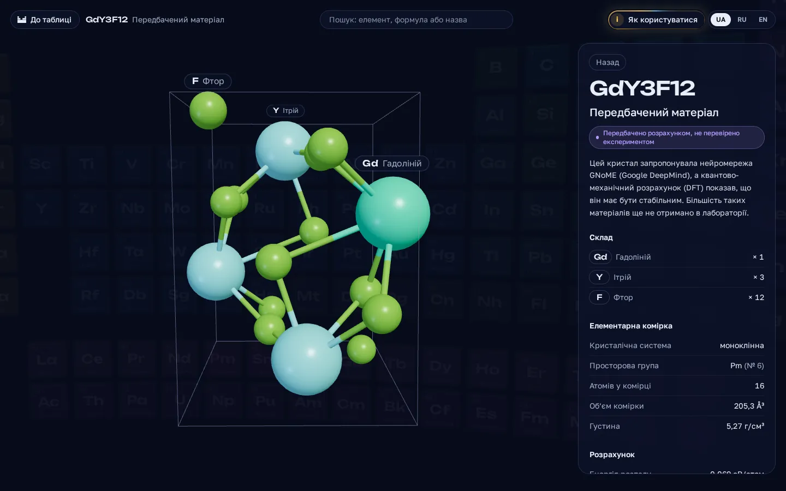

# Периодическая таблица 3D

[English](README.md) · [Українська](README.uk.md) · **Русский**

Интерактивная 3D-таблица Менделеева. Нажмите на элемент и влетите внутрь него. Яркие
лучи ведут к элементам, с которыми он образует соединения. На каждом луче лежат
соединения этой пары. Откройте соединение: его молекула или кристалл медленно вращается
в 3D, а рядом — формула, состав, свойства и источники. Выберите несколько элементов и
увидите облако соединений, которые содержат их все.

**Открыть сайт:** https://vik753.github.io/periodic-3d/ — бесплатно, без регистрации,
в браузере компьютера и на телефоне. Языки интерфейса: украинский, русский, английский.

## Видео-инструкция

**[▶ Смотреть полное видео (2 мин)](https://vik753.github.io/periodic-3d/about?video&lang=ru)**: оно открывается на сайте поверх
таблицы, с паузой и перемоткой. На самом сайте: **Как пользоваться** → **Смотреть
видео**. Файлы видео: [на русском](https://github.com/vik753/periodic-3d/releases/download/guide-2026.10.11-r8/guide-ru.mp4) ·
[на украинском](https://github.com/vik753/periodic-3d/releases/download/guide-2026.10.11-r8/guide-uk.mp4) · [на английском](https://github.com/vik753/periodic-3d/releases/download/guide-2026.10.11-r8/guide-en.mp4).

> [!IMPORTANT]
> **Данные проверены.** Формулы, массы и структуры взяты из открытых научных баз данных и
> сверены между независимыми источниками перед каждым выпуском.
> Подробно: [Как мы гарантируем достоверность данных](#как-мы-гарантируем-достоверность-данных).

## Содержание

1. [Таблица](#1-таблица)
2. [Внутри элемента](#2-внутри-элемента)
3. [Прогулка по лучу](#3-прогулка-по-лучу)
4. [Карточка соединения](#4-карточка-соединения)
5. [Несколько элементов: облако соединений](#5-несколько-элементов-облако-соединений)
6. [Предсказанные материалы (фиолетовые)](#6-предсказанные-материалы-фиолетовые)
7. [Поиск](#7-поиск)
8. [Ссылки, язык и клавиатура](#8-ссылки-язык-и-клавиатура)
9. [На телефоне](#9-на-телефоне)
10. [Вопросы и проблемы](#10-вопросы-и-проблемы)
11. [**Как мы гарантируем достоверность данных**](#как-мы-гарантируем-достоверность-данных)

Технические подробности (данные, архитектура, запуск) — в [английском README](README.md#dataset).

## 1. Таблица

Главный экран показывает все 118 элементов. Плитки висят в пространстве, за ними
медленно летит космическая пыль. Цвет плитки показывает семейство элемента: щелочные
металлы, благородные газы, лантаноиды и так далее.

| Что сделать | Мышь | Сенсорный экран |
| --- | --- | --- |
| Прочитать элемент | Наведите на плитку: она увеличивается, внизу появляется карточка с названием, семейством и массой | Коснитесь плитки один раз |
| Открыть элемент | Нажмите на плитку | Коснитесь той же плитки ещё раз или нажмите **Открыть** на карточке |
| Приблизиться | Прокрутите колесо: таблица приближается к элементу под курсором. Одна-две прокрутки — и одна плитка рядом | Разведите два пальца |
| Приблизиться с клавиатуры | `+` и `−` | — |
| Наклонить или сдвинуть таблицу | Тяните левой кнопкой (наклон) или правой (сдвиг) | Тяните одним или двумя пальцами |

На плитке — атомный номер, символ и название. Буквы остаются чёткими, даже когда одна
плитка занимает весь экран.

## 2. Внутри элемента

Нажмите на плитку. Камера влетает в элемент.

- **Атом.** В центре — модель Бора: ядро и электроны на оболочках. Переключатель
  **Атом / Вещество в 3D** показывает простое вещество: молекулу O₂, кристалл железа,
  слои графита.
- **Красные лучи** ведут к элементам, с которыми этот элемент образует соединения.
  Толстый луч — много общих соединений. Наведите на луч или на плитку партнёра: вы
  увидите количество.
- **Панель** справа (на телефоне — внизу) даёт факты: атомную массу, электронную
  конфигурацию, температуры плавления и кипения, плотность, год открытия, фото вещества,
  известные соединения и похожие элементы.

Чтобы вернуться, нажмите **К таблице** вверху, клавишу `Esc` или пустое место.

## 3. Прогулка по лучу

Нажмите на красный луч. Камера встаёт на луч. Соединения двух элементов выстраиваются
вдоль него: самые известные — первыми.

- Тяните вдоль луча, крутите колесо или нажимайте стрелки: вы переходите от соединения
  к соединению.
- Нажмите на соединение перед вами или на **Открыть карточку**: откроются подробности.
- **К элементу Fe** (или другому символу) возвращает к элементу.

## 4. Карточка соединения

Карточка показывает одно соединение: 3D-модель слева, факты справа.

- **Модель.** Молекула со связями, фрагмент кристаллической решётки или плоская схема,
  если 3D-форма неизвестна. Тяните, чтобы повернуть. Крутите колесо или разведите
  пальцы, чтобы приблизить. Каждый атом имеет цвет и подпись своего элемента.
- **Откуда кристалл.** Под типом модели карточка пишет *Структура из эксперимента (ICSD)*,
  если кристалл измерили в лаборатории, или *Только расчётная структура*, если он есть
  только в расчёте.
- **Формула и состав.** Сколько атомов каждого элемента и молярная масса. Если массу
  вычислили по формуле, карточка это пишет.
- **Проверка источников.** Сайт сравнивает Wikidata, PubChem и структурную формулу
  (SMILES). Если они расходятся, жёлтая заметка объясняет, что показывает карточка и
  почему.
- **Описание** из Википедии, тип вещества (оксид, кислота, минерал…), фото,
  **похожие соединения** и **источники и лицензии** каждого фрагмента данных.
- **Сообщить об ошибке** открывает готовую задачу на GitHub с номером записи. Напишите,
  что не так. Ссылка на источник поможет.

Если у соединения нет 3D-модели, шары показывают состав: один шар — один атом.

## 5. Несколько элементов: облако соединений

Вы можете выбрать несколько элементов и увидеть, что они образуют вместе.

1. Удерживайте `Shift` или `Ctrl` и нажимайте на плитки. На телефоне нажмите
   **Выбрать несколько**, затем касайтесь плиток. Когда закончите, нажмите **Готово**.
2. Внизу экрана появляется панель с выбранными элементами. Нажмите **Показать
   соединения**. **Сбросить выбор** начинает сначала.
3. Появляется облако светящихся шаров: один шар — одно соединение. Наведите на шар,
   чтобы прочитать название. Нажмите, чтобы открыть карточку.

На панели облака вы можете:

- выбрать **Содержат все** (соединения со всеми выбранными элементами, возможно, и с
  другими) или **Только эти** (ничего другого внутри);
- отфильтровать по виду: **Все**, **Органические**, **Неорганические**, **Минералы**;
- увидеть **другие элементы** этих соединений: на таблице они светятся голубым, а клик
  добавляет элемент к выбору;
- добавить **предсказанные материалы**: фиолетовые шары (следующий раздел).

## 6. Предсказанные материалы (фиолетовые)

Рядом с 27 000 известных соединений сайт показывает **554 054 предсказанных кристалла**.
Их предложила нейросеть GNoME (Google DeepMind), а квантово-механический расчёт (DFT)
показал, что они стабильны. Большинство из них ещё никто не получил в лаборатории.

Предсказанные материалы никогда не смешиваются с известными соединениями. Они всегда
**фиолетовые**:

- внутри элемента кнопка **Показать фиолетовые лучи** добавляет фиолетовые лучи к
  партнёрам;
- клик по фиолетовому лучу начинает прогулку по предсказанным материалам пары: простые —
  первыми;
- в облаке кнопка **+ предсказанные материалы** добавляет фиолетовые шары.

Карточка предсказанного материала показывает элементарную ячейку в 3D, кристаллическую
систему, пространственную группу и расчётные свойства: энергию распада (ноль или меньше —
стабилен), энергию образования и ширину запрещённой зоны. Пометка говорит:
*Предсказано расчётом, не проверено экспериментом*.

## 7. Поиск

Поле поиска — вверху. Нажмите `/` или `Ctrl`+`K`, чтобы перейти к нему.

- Введите символ (`Fe`), формулу (`H2O`, `NaCl`) или название на любом из трёх языков
  (`вода`, `water`, `кварц`).
- Стрелки и `Enter` открывают результат. Можно просто нажать на него.
- Идентификатор предсказанного материала (десять символов, например `df6697e2c1`)
  открывает его карточку.

## 8. Ссылки, язык и клавиатура

**У каждого вида свой адрес.** Скопируйте адрес из строки браузера и отправьте его:
человек увидит ту же сцену.

| Адрес | Что открывается |
| --- | --- |
| `/e/Fe` | железо с лучами |
| `/e/Fe/O` | прогулка по лучу железо–кислород |
| `/e/Fe/O/predicted` | прогулка по предсказанным материалам железа и кислорода |
| `/c/Q283` | карточка соединения (здесь вода, по идентификатору Wikidata) |
| `/m/df6697e2c1` | карточка предсказанного материала |
| `/set/Fe-O` | облако соединений железа и кислорода |
| `/about` | как пользоваться сайтом и откуда данные |

**Язык.** Переключатель вверху меняет язык интерфейса: украинский, русский, английский.
Сначала сайт выбирает язык вашего браузера.

**Клавиатура.** `Tab` проходит все 118 элементов по порядку, `Enter` открывает элемент.
`Esc` возвращает назад. `/` открывает поиск. Если система просит меньше движения, камера
перепрыгивает вместо полёта, а пыль и атомы останавливаются.

## 9. На телефоне

- Коснитесь плитки, чтобы увеличить её. Коснитесь ещё раз, чтобы открыть.
- Разведите пальцы, чтобы приблизить. Тяните одним пальцем, чтобы повернуть модель.
- Панель с фактами — внизу экрана. Листайте внутри неё, чтобы читать дальше.
- На медленных телефонах сайт сам снижает качество изображения, чтобы движение
  оставалось плавным.

## 10. Вопросы и проблемы

- **Экран остаётся чёрным.** Сайту нужен WebGL. Обновите браузер или включите
  аппаратное ускорение в его настройках.
- **Данные выглядят неправильно.** Откройте карточку и нажмите **Сообщить об ошибке**.
- **Откуда данные?** Кнопка **Как пользоваться** вверху открывает страницу с версией
  набора данных, источниками и их лицензиями.

## Как мы гарантируем достоверность данных

> [!IMPORTANT]
> Сайт не выдумывает химию. Каждая формула, масса и структура взята из открытых научных
> баз данных. Каждое соединение мы сверяем с несколькими независимыми источниками. Новый
> набор данных попадает на сайт, только когда эталонные вещества проходят проверку. Каждая
> карточка называет свои источники и их лицензии. Любой может сообщить об ошибке одним
> кликом.

### Откуда данные

| Источник | Что берём | Лицензия |
| --- | --- | --- |
| [Wikidata](https://www.wikidata.org) | список соединений, формулы, названия на трёх языках, классы, SMILES, ссылки на PubChem и Materials Project | CC0 |
| [PubChem](https://pubchem.ncbi.nlm.nih.gov) (Национальные институты здоровья США) | формула, молярная масса, название IUPAC, 3D-формы молекул | общественное достояние |
| [Materials Project](https://materialsproject.org) | кристаллические структуры и сведения, измерили ли структуру в лаборатории (записи ICSD) | CC BY 4.0 |
| [Википедия](https://www.wikipedia.org) | описания | CC BY-SA 4.0 |
| [Wikimedia Commons](https://commons.wikimedia.org) | фото с автором и лицензией под каждым | своя у каждого фото |
| [RDKit](https://www.rdkit.org) | 3D-модели, вычисленные по SMILES, если в PubChem их нет | BSD |
| [GNoME](https://github.com/google-deepmind/materials_discovery) (Google DeepMind) | предсказанные кристаллы: отдельный фиолетовый слой | CC BY-NC 4.0 |

### Как мы проверяем

Каждый набор данных проходит одни и те же проверки. Числа ниже — для набора, который сайт
использует сейчас (`data-2026.10.11-r39`).

1. **Только известные вещества.** Соединение попадает в набор, если о нём есть статья в
   Википедии на английском, украинском или русском: 27 202 соединения.
2. **Три независимые записи для каждого соединения.** Мы сравниваем формулу из Wikidata,
   формулу из PubChem и формулу, которая следует из структуры (SMILES). Если две записи
   совпадают, ошибка — в третьей.

   | Результат | Соединений |
   | --- | --- |
   | Wikidata и PubChem совпадают | 22 647 |
   | Записи в PubChem нет (масса вычислена по формуле) | 4 227 |
   | Расходятся, третьего источника нет: карточка показывает обе формулы | 222 |
   | Ссылка на PubChem вела к другому веществу: убрана | 62 |
   | Формула в Wikidata была ошибочной: исправлена | 28 |
   | PubChem описывает гидрат или безводную форму: формула Wikidata остаётся | 12 |
   | Те же пропорции, другой размер (запись димера) | 3 |
   | Изотопы (D, T, ¹⁸F): запись PubChem | 1 |

3. **Осторожные исправления.** Мы меняем формулу только для простых органических молекул
   и очевидных опечаток. Соли, комплексы и неорганические соединения сохраняют свою
   формулу, а карточка честно показывает расхождение. Первые правила были слишком смелыми:
   они «исправили» 239 формул, среди них верные соли и комплексы. Более строгие правила
   оставили 28 настоящих исправлений.
4. **Масса говорит, откуда она.** Это значение из PubChem или масса, вычисленная по
   формуле со стандартными атомными массами. Карточка пишет, что именно.
5. **Каждая 3D-модель должна соответствовать формуле** атом в атом. Сборка отбросила 26
   форм из PubChem, 97 моделей RDKit и 85 кристаллических ячеек, которые не подошли своему
   соединению.
6. **Измеренное раньше рассчитанного.** Для кристаллов мы выбираем структуры, измеренные в
   лаборатории: 4 181 кристалл — из эксперимента (ICSD), 504 — только из расчёта, и
   карточка это пишет. Это правило заменило расчётную структуру 154 соединений (FeO, BeO,
   CuO, V₂O₅, гидроксиапатит…) на измеренную.
7. **Эталонный набор охраняет каждый выпуск.** 19 известных веществ (вода, бензол,
   кофеин, серная кислота, поваренная соль, алмаз, графит, кварц, гематит…) должны получить
   верную формулу, массу с точностью 0,3 %, верный вид 3D-модели и форму ячейки. Если хоть
   одно не проходит, набор не публикуется. Сейчас: 19 из 19.
8. **Известное и предсказанное никогда не смешиваются.** Материалы GNoME всегда
   фиолетовые и помечены «предсказано расчётом, не проверено экспериментом».
9. **Всё задокументировано.** Каждый набор данных — отдельный выпуск на GitHub с полным
   отчётом, где перечислено каждое исправление и каждая убранная ссылка.

### Ошибки, которые мы нашли и исправили

| Где | Что было не так | Что мы сделали |
| --- | --- | --- |
| Wikidata | Хлорат калия записан как KCIO₃: заглавная I вместо l, то есть «углерод и йод» | KClO₃ |
| Wikidata | Зоман (боевое отравляющее вещество) без фосфора: C₇H₁₆FO₂ | C₇H₁₆FO₂P |
| Wikidata | У 1,5-пентандиола не хватало двух атомов водорода: C₅H₁₀O₂ | C₅H₁₂O₂ |
| Wikidata | 2-аминопиридин как C₄H₅N₃ | C₅H₆N₂ |
| Wikidata → PubChem | У индиго была ссылка на индигокармин — натриевую соль другого красителя | ссылка убрана |
| Wikidata → PubChem | У бромида стронция была ссылка на органическое соединение C₁₂H₁₇N | ссылка убрана |
| Wikidata → PubChem | У хлорхромата пиридиния была ссылка на C₁₃H₁₈S | ссылка убрана |
| API Materials Project | API перешёл на буквенные номера (`mp-aaaaaaco` — это `mp-66`, алмаз), и ни один кристалл не получил пометку «измерено / рассчитано» | мы распознаём обе формы; тест это стережёт |

Всего: 28 формул исправлено, 62 ошибочные ссылки убраны, 222 расхождения показаны
открыто.

### Нашли ошибку?

Откройте карточку и нажмите **Сообщить об ошибке**. Откроется готовая задача на GitHub с
номером записи. Напишите, что не так, и, если можете, добавьте ссылку на источник.

## Лицензии

Код — под лицензией MIT. Данные сохраняют лицензии своих источников: Wikidata (CC0),
Википедия (CC BY-SA 4.0), PubChem (NIH, общественное достояние), Materials Project
(CC BY 4.0), Wikimedia Commons (лицензия каждого фото), GNoME от Google DeepMind
(CC BY-NC 4.0). Из-за данных GNoME сайт некоммерческий: без рекламы и без платного
доступа. Подробности — на странице «О проекте» и в [docs/data-sources.md](docs/data-sources.md).
