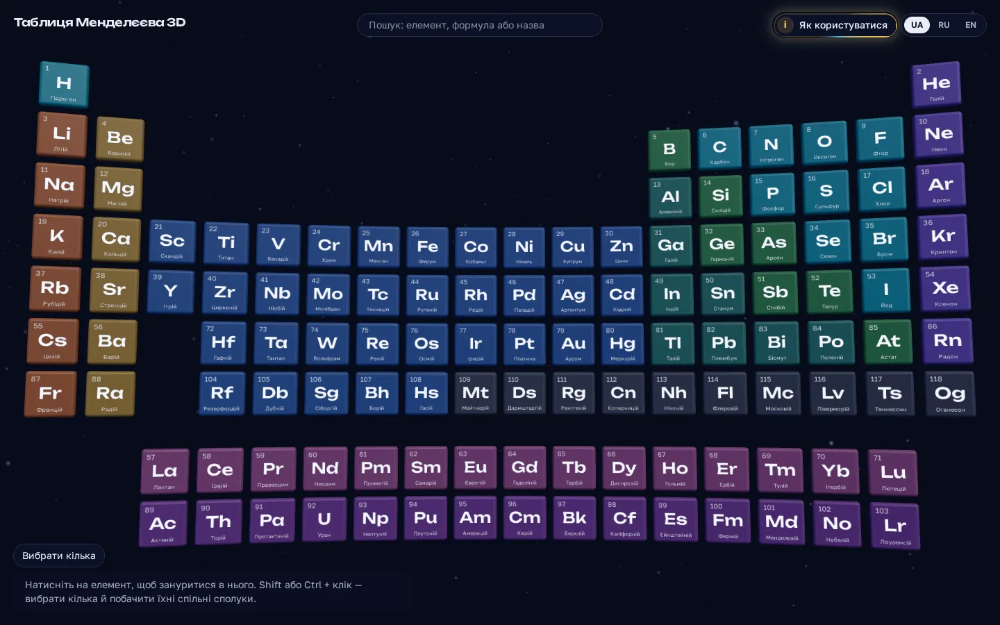

# Періодична таблиця 3D

[English](README.md) · **Українська** · [Русский](README.ru.md)

Інтерактивна 3D-таблиця Менделєєва. Натисніть на елемент і влетіть усередину нього.
Яскраві промені ведуть до елементів, з якими він утворює сполуки. На кожному промені
лежать сполуки цієї пари. Відкрийте сполуку: її молекула або кристал повільно
обертається в 3D, а поруч — формула, склад, властивості та джерела. Виберіть кілька
елементів і побачите хмару сполук, які містять їх усі.

**Відкрити сайт:** https://vik753.github.io/periodic-3d/ — безкоштовно, без реєстрації,
у браузері комп'ютера і на телефоні. Мови інтерфейсу: українська, російська, англійська.

**Хочете відео?** На сайті натисніть **Як користуватися** вгорі, потім **Дивитися відео**:
двохвилинний огляд усіх можливостей вашою мовою.

> [!IMPORTANT]
> **Дані перевірені.** Формули, маси і структури взято з відкритих наукових баз даних і
> звірено між незалежними джерелами перед кожним випуском.
> Докладно: [Як ми гарантуємо достовірність даних](#як-ми-гарантуємо-достовірність-даних).

## Зміст

1. [Таблиця](#1-таблиця)
2. [Усередині елемента](#2-усередині-елемента)
3. [Прогулянка променем](#3-прогулянка-променем)
4. [Картка сполуки](#4-картка-сполуки)
5. [Кілька елементів: хмара сполук](#5-кілька-елементів-хмара-сполук)
6. [Передбачені матеріали (фіолетові)](#6-передбачені-матеріали-фіолетові)
7. [Пошук](#7-пошук)
8. [Посилання, мова і клавіатура](#8-посилання-мова-і-клавіатура)
9. [На телефоні](#9-на-телефоні)
10. [Питання і проблеми](#10-питання-і-проблеми)
11. [**Як ми гарантуємо достовірність даних**](#як-ми-гарантуємо-достовірність-даних)

Технічні подробиці (дані, архітектура, запуск) — в [англійському README](README.md#dataset).

## 1. Таблиця

Головний екран показує всі 118 елементів. Плитки висять у просторі, за ними повільно
летить космічний пил. Колір плитки показує родину елемента: лужні метали, інертні гази,
лантаноїди тощо.

| Що зробити | Миша | Сенсорний екран |
| --- | --- | --- |
| Прочитати елемент | Наведіть на плитку: вона збільшується, внизу з'являється картка з назвою, родиною і масою | Торкніться плитки один раз |
| Відкрити елемент | Натисніть на плитку | Торкніться тієї ж плитки ще раз або натисніть **Відкрити** на картці |
| Наблизитися | Прокрутіть коліщатко: таблиця наближається до елемента під курсором. Одна-дві прокрутки — і одна плитка поруч | Розведіть два пальці |
| Наблизитися з клавіатури | `+` і `−` | — |
| Нахилити або зсунути таблицю | Тягніть лівою кнопкою (нахил) або правою (зсув) | Тягніть одним або двома пальцями |

На плитці — атомний номер, символ і назва. Літери лишаються чіткими, навіть коли одна
плитка займає весь екран.

## 2. Усередині елемента

Натисніть на плитку. Камера влітає в елемент.

- **Атом.** У центрі — модель Бора: ядро і електрони на оболонках. Перемикач
  **Атом / Речовина в 3D** показує просту речовину: молекулу O₂, кристал заліза,
  шари графіту.
- **Червоні промені** ведуть до елементів, з якими цей елемент утворює сполуки. Товстий
  промінь — багато спільних сполук. Наведіть на промінь або на плитку партнера: ви
  побачите кількість.
- **Панель** праворуч (на телефоні — внизу) дає факти: атомну масу, електронну
  конфігурацію, температури плавлення і кипіння, густину, рік відкриття, фото речовини,
  відомі сполуки і схожі елементи.

Щоб повернутися, натисніть **До таблиці** вгорі, клавішу `Esc` або порожнє місце.

## 3. Прогулянка променем

Натисніть на червоний промінь. Камера стає на промінь. Сполуки двох елементів
вишиковуються вздовж нього: найвідоміші — першими.

- Тягніть уздовж променя, крутіть коліщатко або натискайте стрілки: ви переходите від
  сполуки до сполуки.
- Натисніть на сполуку перед вами або на **Відкрити картку**: відкриються подробиці.
- **До елемента Fe** (або іншого символу) повертає до елемента.

## 4. Картка сполуки

Картка показує одну сполуку: 3D-модель ліворуч, факти праворуч.

- **Модель.** Молекула зі зв'язками, фрагмент кристалічної ґратки або плоска схема,
  якщо 3D-форма невідома. Тягніть, щоб обернути. Крутіть коліщатко або розведіть пальці,
  щоб наблизити. Кожен атом має колір і підпис свого елемента.
- **Звідки кристал.** Під типом моделі картка пише *Структура з експерименту (ICSD)*,
  якщо кристал виміряли в лабораторії, або *Лише розрахункова структура*, якщо він є
  тільки в розрахунку.
- **Формула і склад.** Скільки атомів кожного елемента і молярна маса. Якщо масу
  обчислено за формулою, картка це пише.
- **Перевірка джерел.** Сайт порівнює Wikidata, PubChem і структурну формулу (SMILES).
  Якщо вони розходяться, жовта примітка пояснює, що показує картка і чому.
- **Опис** з Вікіпедії, тип речовини (оксид, кислота, мінерал…), фото,
  **схожі сполуки** та **джерела і ліцензії** кожного фрагмента даних.
- **Повідомити про помилку** відкриває готову задачу на GitHub з номером запису. Напишіть,
  що не так. Посилання на джерело допоможе.

Якщо в сполуки немає 3D-моделі, кулі показують склад: одна куля — один атом.

## 5. Кілька елементів: хмара сполук

Ви можете вибрати кілька елементів і побачити, що вони утворюють разом.

1. Утримуйте `Shift` або `Ctrl` і натискайте на плитки. На телефоні натисніть
   **Вибрати кілька**, потім торкайтеся плиток. Коли закінчите, натисніть **Готово**.
2. Внизу екрана з'являється панель з вибраними елементами. Натисніть **Показати
   сполуки**. **Скинути вибір** починає спочатку.
3. З'являється хмара світних куль: одна куля — одна сполука. Наведіть на кулю, щоб
   прочитати назву. Натисніть, щоб відкрити картку.

На панелі хмари ви можете:

- вибрати **Містять усі** (сполуки з усіма вибраними елементами, можливо, й з іншими) або
  **Лише ці** (нічого іншого всередині);
- відфільтрувати за видом: **Усі**, **Органічні**, **Неорганічні**, **Мінерали**;
- побачити **інші елементи** цих сполук: на таблиці вони світяться блакитним, а клік
  додає елемент до вибору;
- додати **передбачені матеріали**: фіолетові кулі (наступний розділ).

## 6. Передбачені матеріали (фіолетові)

Поруч із 27 000 відомих сполук сайт показує **554 054 передбачені кристали**. Їх
запропонувала нейромережа GNoME (Google DeepMind), а квантово-механічний розрахунок (DFT)
показав, що вони стабільні. Більшість із них ще ніхто не отримав у лабораторії.

Передбачені матеріали ніколи не змішуються з відомими сполуками. Вони завжди
**фіолетові**:

- усередині елемента кнопка **Показати фіолетові промені** додає фіолетові промені до
  партнерів;
- клік на фіолетовий промінь починає прогулянку передбаченими матеріалами пари: прості —
  першими;
- у хмарі кнопка **+ передбачені матеріали** додає фіолетові кулі.

Картка передбаченого матеріалу показує елементарну комірку в 3D, кристалічну систему,
просторову групу і розрахункові властивості: енергію розкладу (нуль або менше — стабільний),
енергію утворення і ширину забороненої зони. Позначка каже: *Передбачено розрахунком,
не перевірено експериментом*.

## 7. Пошук

Поле пошуку — вгорі. Натисніть `/` або `Ctrl`+`K`, щоб перейти до нього.

- Введіть символ (`Fe`), формулу (`H2O`, `NaCl`) або назву будь-якою з трьох мов
  (`вода`, `water`, `кварц`).
- Стрілки і `Enter` відкривають результат. Можна просто натиснути на нього.
- Ідентифікатор передбаченого матеріалу (десять символів, наприклад `df6697e2c1`)
  відкриває його картку.

## 8. Посилання, мова і клавіатура

**Кожен вигляд має свою адресу.** Скопіюйте адресу з рядка браузера і надішліть її:
людина побачить ту саму сцену.

| Адреса | Що відкривається |
| --- | --- |
| `/e/Fe` | залізо з променями |
| `/e/Fe/O` | прогулянка променем залізо–кисень |
| `/e/Fe/O/predicted` | прогулянка передбаченими матеріалами заліза і кисню |
| `/c/Q283` | картка сполуки (тут вода, за ідентифікатором Wikidata) |
| `/m/df6697e2c1` | картка передбаченого матеріалу |
| `/set/Fe-O` | хмара сполук заліза і кисню |
| `/about` | як користуватися сайтом і звідки дані |

**Мова.** Перемикач угорі змінює мову інтерфейсу: українська, російська, англійська.
Спочатку сайт вибирає мову вашого браузера.

**Клавіатура.** `Tab` проходить усі 118 елементів по черзі, `Enter` відкриває елемент.
`Esc` повертає назад. `/` відкриває пошук. Якщо система просить менше руху, камера
перестрибує замість польоту, а пил і атоми зупиняються.

## 9. На телефоні

- Торкніться плитки, щоб збільшити її. Торкніться ще раз, щоб відкрити.
- Розведіть пальці, щоб наблизити. Тягніть одним пальцем, щоб обернути модель.
- Панель з фактами — внизу екрана. Гортайте всередині неї, щоб читати далі.
- На повільних телефонах сайт сам знижує якість зображення, щоб рух лишався плавним.

## 10. Питання і проблеми

- **Екран лишається чорним.** Сайту потрібен WebGL. Оновіть браузер або ввімкніть
  апаратне прискорення в його налаштуваннях.
- **Дані виглядають неправильно.** Відкрийте картку і натисніть **Повідомити про помилку**.
- **Звідки дані?** Кнопка **Як користуватися** вгорі відкриває сторінку з версією набору
  даних, джерелами та їхніми ліцензіями.

## Як ми гарантуємо достовірність даних

> [!IMPORTANT]
> Сайт не вигадує хімію. Кожна формула, маса і структура взята з відкритих наукових баз
> даних. Кожну сполуку ми звіряємо з кількома незалежними джерелами. Новий набір даних
> потрапляє на сайт, лише коли еталонні речовини проходять перевірку. Кожна картка називає
> свої джерела та їхні ліцензії. Будь-хто може повідомити про помилку одним кліком.

### Звідки дані

| Джерело | Що беремо | Ліцензія |
| --- | --- | --- |
| [Wikidata](https://www.wikidata.org) | список сполук, формули, назви трьома мовами, класи, SMILES, посилання на PubChem і Materials Project | CC0 |
| [PubChem](https://pubchem.ncbi.nlm.nih.gov) (Національні інститути здоров'я США) | формула, молярна маса, назва IUPAC, 3D-форми молекул | суспільне надбання |
| [Materials Project](https://materialsproject.org) | кристалічні структури і відомість, чи виміряли структуру в лабораторії (записи ICSD) | CC BY 4.0 |
| [Вікіпедія](https://www.wikipedia.org) | описи | CC BY-SA 4.0 |
| [Wikimedia Commons](https://commons.wikimedia.org) | фото з автором і ліцензією під кожним | своя в кожного фото |
| [RDKit](https://www.rdkit.org) | 3D-моделі, обчислені за SMILES, якщо в PubChem їх немає | BSD |
| [GNoME](https://github.com/google-deepmind/materials_discovery) (Google DeepMind) | передбачені кристали: окремий фіолетовий шар | CC BY-NC 4.0 |

### Як ми перевіряємо

Кожен набір даних проходить ті самі перевірки. Числа нижче — для набору, який сайт
використовує зараз (`data-2026.10.11-r39`).

1. **Лише відомі речовини.** Сполука потрапляє в набір, якщо про неї є стаття у Вікіпедії
   англійською, українською або російською: 27 202 сполуки.
2. **Три незалежні записи для кожної сполуки.** Ми порівнюємо формулу з Wikidata, формулу з
   PubChem і формулу, що випливає зі структури (SMILES). Якщо два записи збігаються, помилка
   — у третьому.

   | Результат | Сполук |
   | --- | --- |
   | Wikidata і PubChem збігаються | 22 647 |
   | Запису в PubChem немає (масу обчислено за формулою) | 4 227 |
   | Розходяться, третього джерела немає: картка показує обидві формули | 222 |
   | Посилання на PubChem вело до іншої речовини: прибрано | 62 |
   | Формула у Wikidata була хибна: виправлено | 28 |
   | PubChem описує гідрат або безводну форму: формула Wikidata лишається | 12 |
   | Ті самі пропорції, інший розмір (запис димера) | 3 |
   | Ізотопи (D, T, ¹⁸F): запис PubChem | 1 |

3. **Обережні виправлення.** Ми змінюємо формулу лише для простих органічних молекул і
   очевидних друкарських помилок. Солі, комплекси і неорганічні сполуки зберігають свою
   формулу, а картка чесно показує розбіжність. Перші правила були надто сміливі: вони
   «виправили» 239 формул, серед них правильні солі й комплекси. Суворіші правила
   залишили 28 справжніх виправлень.
4. **Маса каже, звідки вона.** Це значення з PubChem або маса, обчислена за формулою зі
   стандартними атомними масами. Картка пише, що саме.
5. **Кожна 3D-модель має відповідати формулі** атом в атом. Збірка відкинула 26 форм із
   PubChem, 97 моделей RDKit і 85 кристалічних комірок, що не відповідали своїй сполуці.
6. **Виміряне раніше за розраховане.** Для кристалів ми вибираємо структури, виміряні в
   лабораторії: 4 181 кристал — з експерименту (ICSD), 504 — лише з розрахунку, і картка
   це пише. Це правило замінило розрахункову структуру 154 сполук (FeO, BeO, CuO, V₂O₅,
   гідроксиапатит…) на виміряну.
7. **Еталонний набір охороняє кожен випуск.** 19 відомих речовин (вода, бензол, кофеїн,
   сірчана кислота, кухонна сіль, алмаз, графіт, кварц, гематит…) мають отримати правильну
   формулу, масу з точністю 0,3 %, правильний вид 3D-моделі і форму комірки. Якщо хоч одна
   не проходить, набір не публікується. Зараз: 19 з 19.
8. **Відоме і передбачене ніколи не змішуються.** Матеріали GNoME завжди фіолетові й мають
   позначку «передбачено розрахунком, не перевірено експериментом».
9. **Усе задокументовано.** Кожен набір даних — окремий випуск на GitHub з повним звітом,
   де перелічено кожне виправлення і кожне прибране посилання.

### Помилки, які ми знайшли і виправили

| Де | Що було не так | Що ми зробили |
| --- | --- | --- |
| Wikidata | Хлорат калію записано як KCIO₃: велика I замість l, тобто «вуглець і йод» | KClO₃ |
| Wikidata | Зоман (бойова отруйна речовина) без фосфору: C₇H₁₆FO₂ | C₇H₁₆FO₂P |
| Wikidata | У 1,5-пентандіолу бракувало двох атомів водню: C₅H₁₀O₂ | C₅H₁₂O₂ |
| Wikidata | 2-амінопіридин як C₄H₅N₃ | C₅H₆N₂ |
| Wikidata → PubChem | Індиго мало посилання на індигокармін — натрієву сіль іншого барвника | посилання прибрано |
| Wikidata → PubChem | Бромід стронцію мав посилання на органічну сполуку C₁₂H₁₇N | посилання прибрано |
| Wikidata → PubChem | Піридиній хлорхромат мав посилання на C₁₃H₁₈S | посилання прибрано |
| API Materials Project | API перейшов на буквені номери (`mp-aaaaaaco` — це `mp-66`, алмаз), і жоден кристал не отримав позначки «виміряно / розраховано» | ми розпізнаємо обидві форми; тест це стереже |

Загалом: 28 формул виправлено, 62 хибні посилання прибрано, 222 розбіжності показано
відкрито.

### Знайшли помилку?

Відкрийте картку і натисніть **Повідомити про помилку**. Відкриється готова задача на GitHub
з номером запису. Напишіть, що не так, і, якщо можете, додайте посилання на джерело.

## Ліцензії

Код — під ліцензією MIT. Дані зберігають ліцензії своїх джерел: Wikidata (CC0), Вікіпедія
(CC BY-SA 4.0), PubChem (NIH, суспільне надбання), Materials Project (CC BY 4.0), Wikimedia
Commons (ліцензія кожного фото), GNoME від Google DeepMind (CC BY-NC 4.0). Через дані GNoME
сайт некомерційний: без реклами і без платного доступу. Подробиці — на сторінці «Про проєкт»
і в [docs/data-sources.md](docs/data-sources.md).
